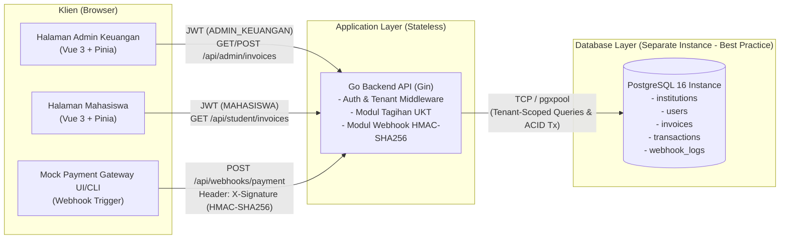
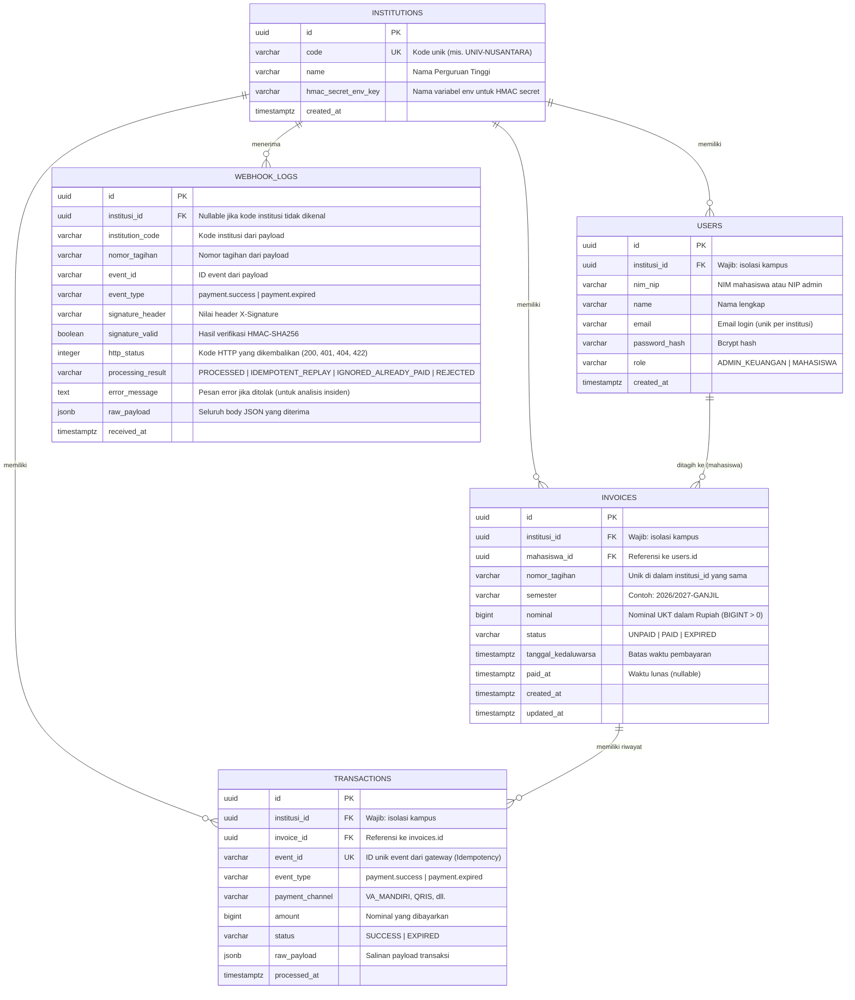
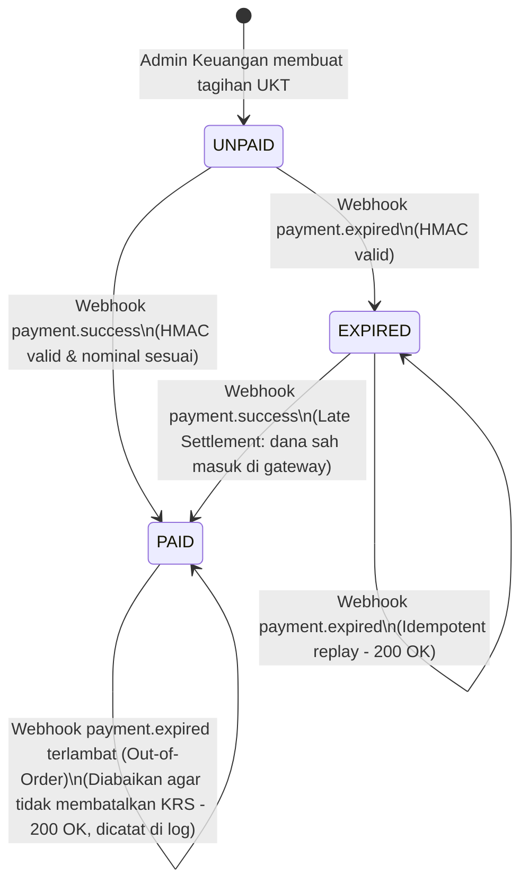
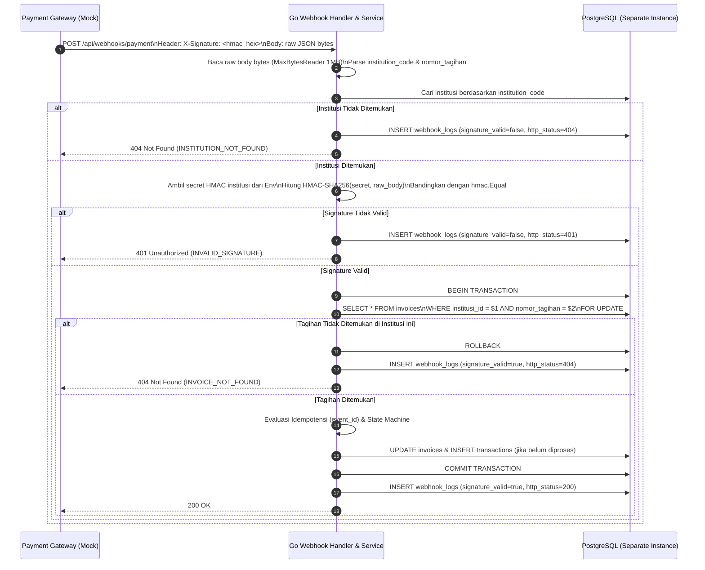

# Architecture & Requirements Document (ARD.md)
**Project M2: Integrasi Pembayaran UKT Multi-Institusi via Webhook**

Dokumen ini menjabarkan arsitektur sistem, pemodelan data (ERD), diagram alur sekuens (*sequence diagram*), mesin status (*state machine*) tagihan UKT, serta rancangan isolasi keamanan multi-institusi.

---

## 1. Gambaran Umum Arsitektur (System Architecture)

Sistem dibangun menggunakan pola **Decoupled Full-Stack Architecture**:
- **Frontend SPA**: Vue 3 + TypeScript + Pinia + Vue Router.
- **Backend REST API & Webhook Receiver**: Go (Gin) dengan *Modular Layered Architecture*.
- **Database**: **Instance PostgreSQL 16 Terpisah** (*Dedicated/Isolated Stateful Instance*), mengikuti *best practice* pemisahan lapisan komputasi aplikasi (*stateless*) dan penyimpanan data (*stateful*).
- **Mock Payment Gateway**: Layanan/modul simulator pihak ketiga yang memicu *webhook* `payment.success` dan `payment.expired` lengkap dengan signature `HMAC-SHA256` per institusi.

---

## 2. Desain Skema Database (Entity-Relationship Diagram)

Seluruh tabel bisnis memiliki relasi langsung ke `institutions` (`institusi_id`) untuk menjamin isolasi data antar-kampus di dalam satu database.

### Constraint Database Penting
1. **`UNIQUE (institusi_id, nomor_tagihan)` pada tabel `invoices`**:
   Memastikan nomor tagihan unik di dalam satu institusi, tetapi **diizinkan sama** pada institusi berbeda.
2. **`UNIQUE (institusi_id, mahasiswa_id, semester)` pada tabel `invoices`**:
   Mencegah pembuatan tagihan ganda untuk mahasiswa yang sama pada semester yang sama di satu institusi.
3. **`CHECK (nominal > 0)` pada tabel `invoices`**:
   Menjamin nominal tagihan selalu bilangan bulat positif.
4. **`UNIQUE (institusi_id, event_id)` pada tabel `transactions`**:
   Menjamin idempotensi di level database agar satu event dari *payment gateway* tidak pernah menghasilkan catatan pembayaran ganda.

---

## 3. State Machine Status Tagihan UKT

Status tagihan mempengaruhi langsung hak akademik mahasiswa dalam mengisi KRS (`status == 'PAID'`). Oleh karena itu, transisi status diatur secara ketat:

### Aturan Transisi Status:
| Status Saat Ini | Event Masuk | Kondisi | Status Baru | Aksi Sistem & Kode HTTP |
|---|---|---|---|---|
| `UNPAID` | `payment.success` | Nominal sesuai | `PAID` | Update tagihan ke `PAID`, tambah baris `transactions`, tulis `webhook_logs` (`200 OK`) |
| `UNPAID` | `payment.success` | Nominal tidak sesuai | `UNPAID` | Tolak perubahan, tulis `webhook_logs` dengan alasan `AMOUNT_MISMATCH` (`422 Unprocessable Entity`) |
| `UNPAID` | `payment.expired` | Valid | `EXPIRED` | Update tagihan ke `EXPIRED`, tambah baris `transactions`, tulis `webhook_logs` (`200 OK`) |
| `PAID` | `payment.success` | Duplikat / Retry | `PAID` | Tidak mengubah tagihan & tidak menduplikasi `transactions`, tulis `webhook_logs` sebagai `IDEMPOTENT_REPLAY` (`200 OK`) |
| `PAID` | `payment.expired` | Out-of-order (terlambat) | `PAID` | Pertahankan `PAID`, tulis `webhook_logs` sebagai `IGNORED_ALREADY_PAID` (`200 OK`) |
| `EXPIRED` | `payment.success` | Late settlement (nominal sesuai) | `PAID` | Update tagihan ke `PAID`, tambah baris `transactions`, tulis `webhook_logs` sebagai `PROCESSED_LATE_SETTLEMENT` (`200 OK`) |

---

## 4. Alur Pemrosesan Webhook & Verifikasi HMAC-SHA256

---

## 5. Matriks Isolasi Hak Akses (RBAC & Multi-Tenancy)

| Aktor | Cara Autentikasi | Sumber `institusi_id` | Hak Akses Data |
|---|---|---|---|
| **Admin Keuangan** | Bearer JWT (`role = ADMIN_KEUANGAN`) | Klaim JWT (`claims.InstitusiID`) | Melihat daftar tagihan, memfilter status, dan membuat tagihan **hanya** untuk mahasiswa di dalam `institusi_id` miliknya. |
| **Mahasiswa** | Bearer JWT (`role = MAHASISWA`) | Klaim JWT (`claims.InstitusiID` & `claims.UserID`) | Melihat status tagihan UKT, status hak pengisian KRS, dan riwayat transaksi **hanya** milik dirinya sendiri di `institusi_id` miliknya. |
| **Payment Gateway** | Header `X-Signature` (`HMAC-SHA256`) | `institution_code` pada payload yang terverifikasi oleh *secret* HMAC institusi tersebut | Memperbarui status tagihan yang berada di bawah `institusi_id` yang sesuai dengan pemilik *secret* HMAC. |
